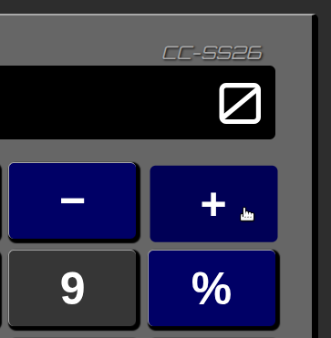

<h2>Classic Calc - Serkan Sarp, 2026</h2>

      
<b>EN: </b>A calculator project designed to work like a classic calculator. Both the JavaScript code and the interface are built around this logic. It also supports keyboard input and visually activates the buttons' :active state when using the keyboard. You can access via <a href="https://serkansarp.github.io/classic-calc">Classic Calc</a> link.

      

      
<b>TR: </b>Klasik bir hesap makinesi mantığıyla çalışan bir hesap makinesi projesidir. JavaScript kodu ve tasarımı bu mantığa uygun olarak oluşturulmuştur. Klavye üzerinden de giriş kabul eder ve klavye girdilerinde butonların :active durumunu görsel olarak aktif hale getirir. <a href="https://serkansarp.github.io/classic-calc">Classic Calc</a> linki üzerinden ulaşabilirsiniz.

